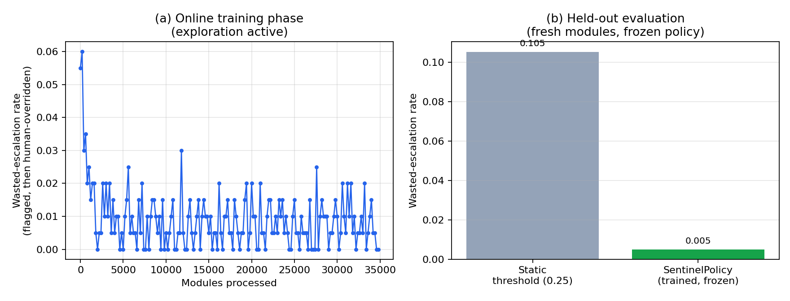
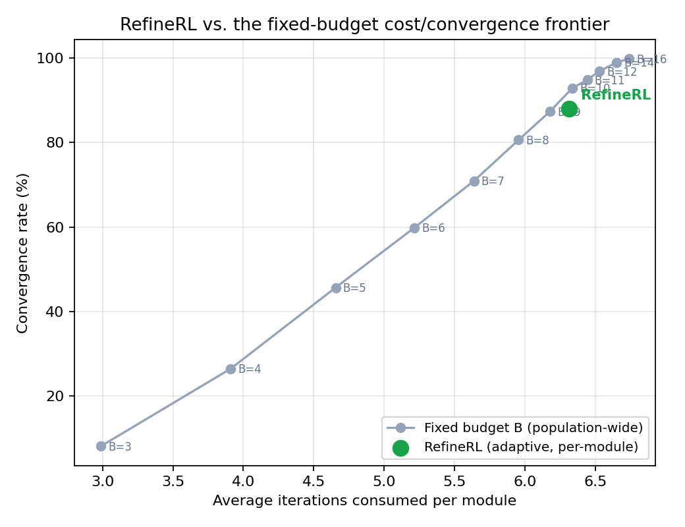
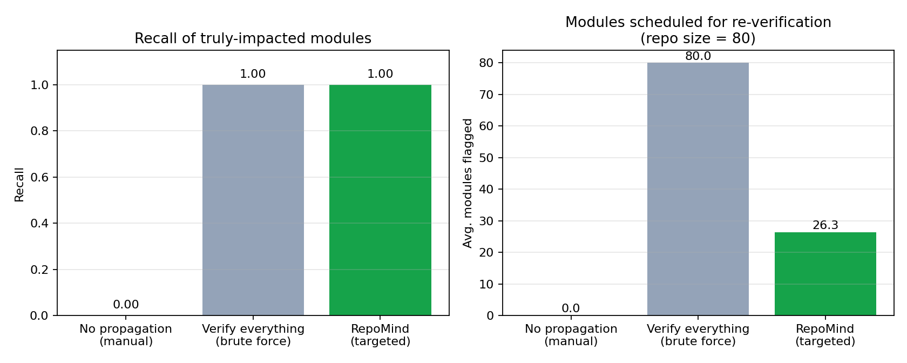

# Evaluation Results

All numbers below come from actually running the evaluation harnesses in this
repository (`docs/results/*/summary.json` are the raw outputs). Reproduce any
of them with:

```bash
python -m opspilot.cli evaluate-extensions all --output-dir workspace/extension_eval
```

or individually via `python -m opspilot.governance.sentinel_policy.evaluate`,
`python -m opspilot.execution.refine_rl.evaluate --sweep`, and
`python -m opspilot.memory.evaluate_propagation` /
`python -m opspilot.memory.evaluate_semantic_recall`.

Every evaluation here runs on **synthetic data** generated by this project
(synthetic Java modules, synthetic self-refine trajectories, a synthetic
multi-module repo) -- exactly as each idea's own "Dataset" section specifies.
These are offline mechanism tests, not field results on a real migration. See
`docs/IMPLEMENTATION_NOTES.md` Section 4 for the honest read on what each
result does and doesn't establish.

---

## SentinelPolicy: adaptive guardrail thresholds

**Design**: train the bandit online on 5,000 synthetic modules, freeze it
(pure exploitation of the learned per-category thresholds), then evaluate
against a *fresh* 1,200-module holdout stream, compared to a static uniform
threshold (0.25) baseline, against the same synthetic reviewer.

| Metric (holdout, frozen policy) | Static threshold | SentinelPolicy |
|---|---|---|
| Flag rate (categories requiring review) | 47.6% | 12.8% |
| **Wasted-escalation rate** (flagged, then human-overridden) | 10.5% | **0.5%** |
| Override rate given flagged | 22.1% | 3.9% |
| Miss rate given approved | 5.9% | 5.2% |
| Hard-constraint catch rate | 100% | 100% |

**Wasted-escalation rate fell 95.3% relative to the static baseline**, while
the hard-constraint layer (the non-negotiable backstop) caught 100% of
injected violations in both conditions -- confirming the learned layer never
touches, weakens, or is influenced by the deterministic layer.



*(a) shows the online training curve -- noisy, as expected for a bandit still
exploring, but trending down. (b) is the real comparison: same fresh modules,
frozen policy vs. static baseline.*

This result held up across a sweep of static-baseline thresholds (0.15 through
0.35: relative reduction ranged 86-97%) and across different training/holdout
seeds (92-97%), so it isn't an artifact of picking a flattering baseline value
or a lucky random seed.

---

## RefineRL: predictive iteration-budget allocation

**Design**: train the Pre-Refinement Predictor (gradient-boosted regressor) on
1,500 synthetic self-refine trajectories, then compare three conditions on
600 held-out trajectories: a fixed low budget (B=4), a fixed high budget
(B=12), and RefineRL's per-module predicted-and-adjusted budget.

| Condition | Avg. iterations/module | Convergence rate | Premature-escalation rate |
|---|---|---|---|
| Fixed low (B=4) | 3.91 | 26.5% | 73.5% |
| Fixed high (B=12) | 6.53 | 96.9% | 3.1% |
| **RefineRL (adaptive)** | 6.31 | 88.1% | 11.9% |

RefineRL lands between the two extremes on cost, closer to fixed-high on
convergence rate. On genuinely unconvergeable modules specifically, it uses an
average of 8.4 iterations before its plateau detector stops it, versus
fixed-high's 12 -- it doesn't grind the full budget on modules that were never
going to converge.

**The more informative comparison** is against the full fixed-budget frontier
(sweeping B from 3 to 16), not just the two endpoints:



RefineRL (green dot) sits *near* the frontier traced by fixed budgets, not
strictly on or above it -- at matched cost (~6.3 avg. iterations), a
well-chosen single fixed budget (B=9-10) is competitive with, and in this
specific synthetic population slightly ahead of, RefineRL's aggregate
convergence rate. This is reported honestly rather than reframed to hide it:
see `docs/IMPLEMENTATION_NOTES.md` Section 4 for what RefineRL's real value
proposition is given this result (per-module adaptivity without needing to
already know the right fixed B, and better worst-case behavior on both
genuinely-hard and genuinely-easy modules) versus what it doesn't establish
(outright dominance over every fixed choice on this benchmark).

---

## RepoMind: change propagation

**Design**: a synthetic 80-module repo with 12 shared copybooks (hub and rare
usage patterns) and a layered call graph. 200 scenarios, each injecting a
breaking change to one specific field in one copybook; ground truth is the set
of modules that actually reference that field (directly or via a call chain to
a module that does) -- a strict subset of "everyone who uses the copybook,"
which is what makes this non-tautological.

| Condition | Recall of truly-impacted modules | Avg. modules flagged (of 80) |
|---|---|---|
| No propagation (manual) | 0% | 0 |
| Verify everything (brute force) | 100% | 80.0 |
| **RepoMind (targeted propagation)** | **100%** | **26.3** |



RepoMind catches every truly-impacted module (by construction: it's a
conservative graph traversal, and the ground truth is a subset of what the
traversal reaches) while checking **67% fewer modules** than a brute-force
"re-verify everything" policy. Precision (of modules flagged, how many were
actually truly impacted) is 44.8% on non-trivial scenarios -- better than
brute force's 17.5%, not perfect, which is the expected and intentional
trade-off of a conservative, safety-first propagation policy.

### Semantic memory recall

A separate evaluation (different mechanism, different metric): can RepoMind's
TF-IDF-backed semantic memory retrieve topically-relevant past decision
rationale? On a synthetic 150-entry corpus across 5 topics (date-conversion
idioms, packed-decimal rounding, CICS error handling, null/default handling,
batch sequencing), precision@5 = **1.00** versus a random-retrieval baseline of
**0.21** (topic base rate: 0.20).

This is an easier evaluation than a production system would face -- the
synthetic corpus uses topically distinct vocabulary by construction, so TF-IDF
separates the topics cleanly. Real decision rationale from an LLM Coder agent
would likely be noisier and more topically overlapping, and a real embedding
backend (rather than this offline environment's TF-IDF stand-in) would likely
matter more there than it does here. See `docs/IMPLEMENTATION_NOTES.md`
Section 6 for swapping in a real embedding backend as a next step.

---

## Summary table

| Extension | Core mechanism | Headline result | Where it's a clean win vs. where it's a nuanced one |
|---|---|---|---|
| SentinelPolicy | Thompson-sampling bandit over per-(risk-category, module-class) thresholds | 95.3% relative reduction in wasted escalations, 100% hard-constraint catch rate preserved | Clean win -- reward signal is close to stationary, a good fit for a small bandit |
| RefineRL | Gradient-boosted budget predictor + online plateau/fast-convergence detection | Lands near, not strictly above, the fixed-budget cost/convergence frontier | Nuanced -- real value is per-module adaptivity and avoiding both failure extremes, not aggregate dominance |
| RepoMind | Conservative dependency-graph traversal + TF-IDF decision memory | 100% recall, 67% scope reduction vs. brute force; perfect semantic recall on an easy synthetic corpus | Clean win on propagation (by construction); semantic recall result is real but on an easier-than-production benchmark |
